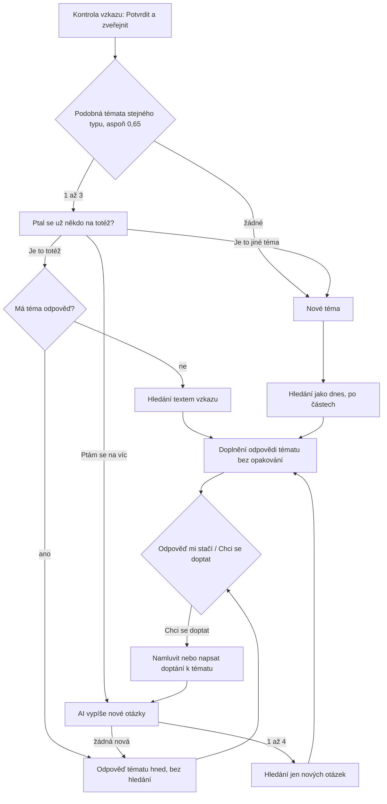

# Témata ve feedu: jedna odpověď na téma

*Návrh z 13. 11. 2026, fáze A úkolu v [zadani-temata-feedu.md](zadani-temata-feedu.md). Požadavky F-33 až F-37 a F-81. Je to rozšíření MVP pro zkušební provoz. **Čeká na schválení Tomášem, nic z toho zatím není postavené.***

## Shrnutí návrhu

- Feed ukazuje **témata**, ne jednotlivé vzkazy. Téma má hlavní dotaz, odpověď, poddotazy s jejich částí odpovědi a připojené vzkazy.
- Po potvrzení textu ucho najde **nejvýš 3 podobná témata** podle embeddingu textu a názvu, bez jazykového modelu. Trvá to asi 0,3 s.
- Autor zvolí **Je to totéž**, **Ptám se na víc**, nebo **Je to jiné téma**. Teprve potom se vzkaz uloží. Nic se nesloučí samo.
- U „Ptám se na víc“ AI vypíše jen otázky, na které odpověď tématu ještě neodpovídá, a hledá se jen na ně.
- Odpověď tématu se **skládá z částí**, AI ji nepřepisuje. Každá věta prošla ověřením jako dnes. Kód nepustí opakovanou větu ani zdroj. Rozpor pozná krátká kontrola modelem a novější údaj vyhraje.
- Ukázky jsou témata. `v-2j1g3o2u57` se připojí k `ukazka-03` jako poddotaz a doplní, koho kontaktovat a že nájemce musí mít 18 let.
- Cena zařazení je zanedbatelná (asi 0,03 neuronu). „Totéž“ u zodpovězeného tématu je o asi 80 neuronů levnější než dnes, protože se znovu nehledá.

## Proč Sokolovna neprošla

Dnešní opakovaný dotaz porovná embedding celého textu a spojí jen dvojice s podobností aspoň 0,85. Skutečný dotaz `v-2j1g3o2u57` má proti `ukazka-03` jen **0,802**. Je dlouhý a nese okolnosti (party pro 15 lidí, narozeniny) a další dvě otázky (koho se zeptat, jak zažádat). Ty ho od krátké ukázky vzdálí.

Měření ukázalo, že žádný práh podobnosti stejná a různá témata neoddělí. Nejnižší podobnost správného tématu byla 0,71, nejvyšší podobnost záludného jiného tématu 0,76 (vstupné na koupaliště proti koupání psů v Písečácích). Správné téma ale bylo vždy mezi třemi nejbližšími. Proto rozhoduje autor a ucho mu jen nabídne tři nejbližší.

## Měření (13. 11. 2026)

Skript `npx tsx nastroje/mereni-temat.ts` (celý výstup v `mereni-temat.json` ve složce dat). Témata: 32 ukázek a jediný uložený vzkaz z ostré D1 (`v-2j1g3o2u57`). 18 dotazů: skutečný dotaz na Sokolovnu a dvojice jako v [feed-vzkazu.md](feed-vzkazu.md), tedy stejná otázka jinými slovy, poddotaz a záludné jiné téma na stejném místě. Celkem 18 dvojic totéž nebo poddotaz a 13 záludných dvojic „jiné téma“. Sadu pro sdružování (fáze B) to nenahrazuje.

### Způsoby hledání podobného tématu

| Způsob | Správné téma mezi 3 nejbližšími | Na 1. místě | Nejnižší správné | Nejvyšší záludné jiné | Čas (medián, max) | Neuronů na vzkaz |
|---|---|---|---|---|---|---|
| Embedding celého textu (dnes) | 18 z 18 | 16 z 18 | 0,64 | 0,75 | 0,27 s, 0,38 s | 0,03 (oba embeddingy) |
| Embedding názvu | 18 z 18 | 16 z 18 | 0,60 | 0,76 | v tomtéž volání | |
| **Vyšší z obou (text, název)** | **18 z 18** | **16 z 18** | **0,71** | **0,76** | v tomtéž volání | |
| Text proti tématu i s odpovědí | 18 z 18 | 16 z 18 | 0,58 | 0,58 | v tomtéž volání | |
| Části dotazu z `casti.ts` | 18 z 18 | 16 z 18 | 0,64 | 0,75 | 0,81 s, 2,5 s | 4,5 |
| Reranker `bge-reranker-base` | 17 z 18 | 16 z 18 | 0,00 | 0,03 | 0,32 s, 0,66 s | 0,5 |
| Jazykový model nad 5 nejbližšími | viz níže | | | | 1,9 s, 7,1 s | 9,9 |

- **Embedding** stačí na nabídku. Vyšší ze dvou podobností (text proti textu, název proti názvu) dá správnému tématu největší odstup. Název je výstup AI úpravy, takže nic nestojí.
- **Části dotazu** nepomohly. Sokolovna má po rozdělení 0,74 místo 0,80, protože ukázka je dotaz celý.
- **Reranker** česky nefunguje: skóre kolem nuly, kontakt na pronájem Sokolovny dal `ukazka-03` na 31. místo.
- **Jazykový model** (Gemma, stejný jako u odpovědí) určil vztah u všech 30 dvojic, které vrátil, správně jako „stejné téma“, nebo „jiné téma“. Poddotaz ale u 4 ze 6 dvojic označil jako „totéž“, i u Sokolovny. Zdrží nabídku o 2 až 7 s.

### Sokolovna a dvojice z feedu

Podobnost s očekávaným tématem (v závorce pořadí mezi všemi tématy).

| Dotaz | Téma | Vztah | Text | Název | Vyšší z obou | Model |
|---|---|---|---|---|---|---|
| skutečný dotaz na Sokolovnu | ukazka-03 sál | poddotaz | 0,80 (1) | 0,75 (1) | 0,80 (1) | totéž |
| skutečný dotaz na Sokolovnu | ukazka-17 hospoda | jiné | 0,58 (2) | 0,60 (2) | 0,60 (2) | jiné |
| skutečný dotaz na Sokolovnu | ukazka-29 pítko | jiné | 0,56 (3) | 0,49 (3) | 0,56 (3) | jiné |
| Kolik stojí pronájem sálu v sokolovně? | ukazka-03 | totéž | 0,76 (1) | 0,92 (1) | 0,92 (1) | totéž |
| totéž | v-2j1g3o2u57 | totéž | 0,64 (2) | 0,71 (2) | 0,71 (2) | totéž |
| Koho mám kontaktovat, když si chci pronajmout Sokolovnu? | ukazka-03 | poddotaz | 0,73 (2) | 0,82 (1) | 0,82 (1) | totéž |
| Otevře se v Sokolovně zase hospoda? | ukazka-03 | jiné | 0,61 (2) | 0,67 (2) | 0,67 (2) | jiné |
| Kolik stojí pronájem tělocvičny ve škole na hodinu? | ukazka-03 | jiné | 0,62 (1) | 0,62 (1) | 0,62 (1) | jiné |
| Jak dlouho má lékárna ve čtvrtek otevřeno? | ukazka-01 | totéž | 0,89 (1) | 0,77 (1) | 0,89 (1) | totéž |
| Má lékárna na zdravotním středisku otevřeno i v sobotu? | ukazka-01 | poddotaz | 0,85 (1) | 0,69 (1) | 0,85 (1) | totéž |
| Smí se pes koupat v Písečáku? | ukazka-02 | totéž | 0,92 (1) | 0,94 (1) | 0,94 (1) | totéž |
| Kolik stojí vstupné na koupaliště v Písečácích? | ukazka-02 | jiné | 0,75 (1) | 0,76 (1) | 0,76 (1) | jiné |
| Jak velký úvěr si obec vzala na stavbu bytů? | ukazka-10 | totéž | 0,89 (1) | 0,88 (1) | 0,89 (1) | totéž |
| totéž | ukazka-11 pro koho byty | jiné | 0,52 (4) | 0,54 (2) | 0,54 (3) | jiné |
| Kolik bude měsíčně stát nájem v těch nových bytech u DPS? | ukazka-11 | poddotaz | 0,84 (1) | 0,90 (1) | 0,90 (1) | poddotaz |
| Kdo staví cyklostezku k Jizeře a kdy se začne? | ukazka-09 | totéž | 0,89 (1) | 0,89 (1) | 0,89 (1) | totéž |
| Kdo je nový starosta? | ukazka-07 | totéž | 0,76 (1) | 0,60 (1) | 0,76 (1) | totéž |
| Kdo je teď místostarosta obce? | ukazka-07 | totéž | 0,80 (1) | 0,63 (1) | 0,80 (1) | totéž |

S navrženým prahem nabídky 0,65 (vyšší z obou) by se nabídla všechna správná témata. Ze 13 záludných jiných témat by se nabídla 3 (sál u hospody, úvěr u nájmu, koupání psů u vstupného) a autor by zvolil „Je to jiné téma“. Tělocvična (0,62) by nabídku nedostala a založila by nové téma bez ptaní.

### Co se ptá navíc (nové otázky)

AI dostane téma s odpovědí a nový vzkaz a vypíše jen otázky, na které odpověď ještě neodpovídá. Na 18 dvojicích totéž a poddotaz:

- U 11 z 12 dvojic „totéž“ vrátila prázdný seznam. Výjimka je výběh pro psy, který odpověď nemá, takže je nová každá otázka. To je správně.
- U všech 6 poddotazů vrátila právě ten nový detail. U Sokolovny: „Kdo je správnou osobou pro dotaz a žádost o pronájem sálu v Sokolovně?“ a „Jakým způsobem je nutné zažádat o pronájem sálu v Sokolovně?“. Cenu, kterou ukázka už má, vynechala.
- Medián 0,7 s, asi 4 neurony. To je stejně jako dnešní rozdělení dotazu, které tento krok u poddotazu nahradí.

### Opakovaná věta a rozpor

| Dvojice vět | Očekávané | Podobnost embeddingu | Model |
|---|---|---|---|
| cena sálu z ukázky × cena sálu ze skutečného dotazu | totéž jinými slovy | 0,90 | bez rozporu |
| cena sálu × cena sálu s jinými čísly | rozpor | 0,87 a 0,97 | rozpor |
| lékárna čtvrtek × lékárna čtvrtek jinak | rozpor | 0,85 | rozpor |
| lékárna čtvrtek × lékárna pátek | různé věci | 0,92 | bez rozporu |
| sál × přísálí, sál × celá sokolovna, přísálí × celá sokolovna | různé věci | 0,75 až 0,83 | bez rozporu |
| sál × kuchyň, sál × správce | různé věci | 0,37 až 0,65 | bez rozporu |

Embedding věty rozpor nepozná: čtvrtek a pátek v lékárně mají 0,92, skutečný rozpor 0,85. Model rozhodl všech 10 dvojic správně za 13 neuronů a 3,7 s. Proto: embedding vybere kandidáty (aspoň 0,75), rozhodne model.

**Celková cena měření:** asi 390 neuronů (první běh 297, nové otázky 74, věty 13).

## Datový model a migrace 0003

Drží se entit PRD (Téma, Podnět, Odpověď). Tabulka `vzkaz` zůstává jako Podnět.

```sql
-- Téma (F-33). Ukázka se stane řádkem až při prvním připojeném vzkazu, do té doby žije jen v ukazky.json.
CREATE TABLE tema (
  id TEXT PRIMARY KEY,                -- „t-…“, u ukázky její id („ukazka-03“)
  ukazka INTEGER NOT NULL DEFAULT 0,
  vytvoreno TEXT NOT NULL,
  zmeneno TEXT NOT NULL,              -- poslední změna: nový vzkaz nebo nová část odpovědi
  nazev TEXT NOT NULL,
  text TEXT NOT NULL,                 -- hlavní dotaz: kopie textu zakladatele nebo ukázky
  typ TEXT NOT NULL CHECK (typ IN ('dotaz', 'navrh', 'stiznost', 'pochvala')),
  oblast TEXT NOT NULL,
  stav TEXT NOT NULL CHECK (stav IN ('zodpovezeno-z-webu', 'ceka-na-spravce', 'sloucene')),
  hlavni_id TEXT REFERENCES tema (id), -- sloučené téma odkazuje na hlavní (PRD)
  skryto INTEGER NOT NULL DEFAULT 0
);
CREATE INDEX tema_feed ON tema (skryto, zmeneno);

-- Podnět: vazba na téma a vztah podle PRD. Název má vlastní embedding (měření: vyšší z text a název).
ALTER TABLE vzkaz ADD COLUMN tema_id TEXT REFERENCES tema (id);
ALTER TABLE vzkaz ADD COLUMN vztah TEXT CHECK (vztah IN ('zakladatel', 'totez', 'poddotaz', 'doplneni'));
ALTER TABLE vzkaz ADD COLUMN vektor_nazvu BLOB;
ALTER TABLE vzkaz ADD COLUMN potvrzeni TEXT CHECK (potvrzeni IN ('staci', 'doptani')); -- F-81
CREATE INDEX vzkaz_tema ON vzkaz (tema_id);
ALTER TABLE vektor_ukazky ADD COLUMN vektor_nazvu BLOB;

-- Odpověď k tématu (vzkaz_id NULL = hlavní dotaz) nebo k poddotazu. Citace jsou kopie v JSON.
CREATE TABLE odpoved (
  id TEXT PRIMARY KEY,
  tema_id TEXT NOT NULL REFERENCES tema (id),
  vzkaz_id TEXT REFERENCES vzkaz (id),
  vytvoreno TEXT NOT NULL,
  puvod TEXT NOT NULL CHECK (puvod IN ('web', 'ukazka')),
  stav TEXT NOT NULL CHECK (stav IN ('platna', 'ke-kontrole', 'stazena')),
  duvod TEXT,                          -- u ke-kontrole a stažené: novejsi-zdroj, autor-upravil, tym
  nahrazena_id TEXT REFERENCES odpoved (id),
  otazka TEXT,                         -- otázka části (nová otázka poddotazu), u hlavní odpovědi prázdná
  obsah TEXT NOT NULL                  -- JSON: věty (text, url zdroje), zdroje (url, název, datum, úryvek, místo)
);
-- Nejvýš jedna platná odpověď na hlavní dotaz a na každý poddotaz.
CREATE UNIQUE INDEX odpoved_platna ON odpoved (tema_id, ifnull(vzkaz_id, '')) WHERE stav = 'platna';
```

- **Skóre tématu** (F-42) a hlasy nepřibudou, nejsou v úkolu.
- **Citace** zůstanou kopií v JSON odpovědi, jako dnes ve `vzkaz.odpoved`. Tabulka `citace` z migrace 0001 zůstane prázdná: má cizí klíč na `zdrojovy_dokument` a obnova indexu dokumenty maže a nahrává znovu, takže by se zastavila.
- `vzkaz.odpoved` zůstává jako „co autor viděl“. Feed ho už neukazuje, ukazuje odpověď tématu.
- Embedding se nově počítá u všech typů vzkazů, nejen u dotazu, aby šly sdružovat i návrhy.

## Tok obrazovek



Uloží se až po volbě autora (F-14). Kdo zavře panel na obrazovce s výběrem, dostane stejnou otázku jako dnes při zavření neuloženého vzkazu.

**1. Kontrola vzkazu.** Beze změny. Tlačítko **Potvrdit a zveřejnit**. Stránka pošle vzkaz na `POST /ucho/api/dotaz` bez volby tématu.

**2. Podobná témata (nová obrazovka, jen když nějaké jsou).** Server spočítá embedding textu a názvu (jedno volání, asi 0,3 s), porovná je se všemi vzkazy témat a s ukázkami stejného typu a vrátí nejvýš 3 témata s podobností aspoň 0,65. Nic neuloží.

> **Ptal se už někdo na totéž?**
> Ve feedu jsou podobná témata. Vyberte, jak s nimi váš vzkaz souvisí. Zveřejní se až potom.
>
> **Pronájem sálu v Sokolovně** · Zodpovězeno · Dotaz · Ukázka · 1 vzkaz
> „Dobrý den, chtěla bych si na jaře pronajmout sál v Sokolovně…“
> Odpověď: Obec upravila výši pronájmu samotného sálu sokolovny na 4.000,- Kč plus energie… ¹ (Zdroje rozbalitelně)
> [Je to totéž] [Ptám se na víc]
>
> *(další nejvýš dvě témata)*
>
> [Je to jiné téma] [Zpět k úpravám]

U návrhu, stížnosti a pochvaly jsou tlačítka **Je to totéž** a **Doplňuji to**. Fokus jde na nadpis, čtečka oznámí „Našli jsme 2 podobná témata.“ Všechno jsou tlačítka v pořadí čtení, ovládají se klávesnicí.

**3a. Je to totéž.** Vzkaz se uloží k tématu (vztah `totez`). Když téma má odpověď, panel ji ukáže hned i s hlavním dotazem, bez nového hledání (F-37). Když ji nemá, hledá se textem nového vzkazu (diagram PRD: téma bez odpovědi jde na web). Nalezená odpověď se stane odpovědí hlavního dotazu a téma přejde na Zodpovězeno.

**3b. Ptám se na víc.** Vzkaz se uloží jako poddotaz (`poddotaz`, u návrhů `doplneni`). AI vypíše otázky, na které odpověď tématu ještě neodpovídá. Panel je ukáže stejně jako dnes části dotazu („Hledáme odpověď na to, co téma ještě nemá“) a hledá jen je. Nalezené věty doplní odpověď tématu, panel je ukáže jako „Nově doplněno“. Když AI nic nového nenajde, panel ukáže odpověď tématu s větou „Odpověď tématu na váš dotaz už odpovídá.“

**3c. Je to jiné téma, nebo nic podobného.** Vznikne nové téma (vzkaz je `zakladatel`) a odpověď se hledá jako dnes.

**4. Odpověď mi stačí / Chci se doptat (F-81).** Pod každou odpovědí. „Stačí“ zapíše potvrzení k vzkazu a panel nabídne Nový vzkaz. „Chci se doptat“ otevře namluvení nebo psaní s pruhem „Doptáváte se k tématu Pronájem sálu v Sokolovně“. Doptání projde AI úpravou a potvrzením a pak rovnou krokem 3b, bez výběru tématu. Potvrzení se zapíše jen s podpisem návrhu, který má jen autorova stránka.

**Feed po potvrzení.** Panel pošle feedu změněné téma. Téma se ve feedu nahradí a přesune na začátek, bez obnovení stránky.

## Feed po tématech

- **Položka:** název tématu a jeden řádek: tečka a stav, typ, „3 vzkazy“ a datum poslední změny. U ukázky štítek Ukázka a počet připojených vzkazů, když nějaké má.
- **Po rozkliknutí:**
  - hlavní dotaz;
  - odpověď tématu: věty hlavní odpovědi, pod nimi poddotazy jako mezititulky s jejich větami;
  - poddotazy bez odpovědi: „Čeká na odpověď: …“;
  - zdroje číslované přes celé téma (jeden odkaz je jeden zdroj) a upozornění, že nejde o úřední vyjádření obce;
  - „Vzkazy k tématu (3)“ sbalené: text každého vzkazu, datum, vztah („Ptá se na víc“) a rozbalovací „Ve stylu: Marvin“ jako dnes.
- **Pořadí:** témata se skutečnými vzkazy podle poslední změny, za nimi ukázky bez vzkazů. Nejvýš 200 témat.
- **Filtry a počty** zůstávají (stav, typ), počítají se témata. **Hledání** prochází název, texty všech vzkazů tématu a věty odpovědi.
- **Stav tématu:** Zodpovězeno, když má platnou odpověď hlavní dotaz. Jinak Čeká na odpověď. Návrhy, stížnosti a pochvaly čekají vždy.
- Odpověď ve feedu je vždy spisovně. Alternativní mluvčí zůstávají u přímého namlouvání.

## Skládání odpovědi tématu

Odpověď tématu se **skládá z částí**, AI ji nepřepisuje ani neshrnuje. Každá část je řádek `odpoved`: hlavní odpověď a nejvýš jedna platná část na každý poddotaz. Feed je ukáže jako jednu odpověď.

1. Každá věta vznikla dnešní cestou: hledání, odpověď jen z úryvků, kontrola citace kódem, ověřovací model a kontrola čísel (F-73 až F-76). Složení na tom nic nemění, nová věta ani číslo nevzniknou.
2. **Stejný zdroj** se nepřidá znovu: zdroje se číslují přes celé téma podle adresy, jako dnes u částí jednoho dotazu.
3. **Opakovaná věta** se nepřidá. Rozhodne kód, když nová věta cituje stejnou adresu a citace se překrývá s citací existující věty. Jinak kód vybere dvojice vět s podobností embeddingu aspoň 0,75 a rozhodne model: totéž, rozpor, nebo různé věci.
4. **Rozpor:** novější zdroj vyhraje (stejně jako prompt odpovědi verze 5). Starší část se nesmaže: dostane stav **ke kontrole** (důvod `novejsi-zdroj`) a místo ní vznikne platná část bez sporné věty. Tým ji uvidí ve výpisu tématu. Když je novější starší věta, zahodí se nová věta.
5. Když po odebrání opakovaných vět nic nezbude, poddotaz nedostane vlastní část. Panel ukáže odpověď tématu.

Proč ne souhrn od AI: souhrn by byl nový text, který musí znovu projít ověřením proti úryvkům. Uložené jsou ale jen citace, ne celé úseky, a každé přepsání by mohlo změnit číslo nebo smysl. Skládání z ověřených vět F-73 až F-76 splní bez nového rizika.

## Návrhy, stížnosti a pochvaly

Sdružují se stejně jako dotazy, jen s tématy stejného typu a bez hledání odpovědi (F-72). Volby jsou **Je to totéž** (počítá se jako další vzkaz) a **Doplňuji to** (vztah `doplneni` z PRD). Doplnění se ve feedu ukáže pod hlavním textem. Dotaz a návrh na stejnou věc (pítko u Sokolovny) zůstanou dvě témata, tým je může sloučit příkazem.

## Převod stávajících vzkazů

Na ostré D1 je 13. 11. 2026 jeden vzkaz. Převod je příkaz `npx tsx nastroje/vzkazy.ts prevest`:

1. Bez parametru jen vypíše, co by udělal: každý vzkaz bez tématu, nejbližší 3 témata s podobností a navržené zařazení.
2. S `--provest` založí každému vzkazu bez tématu vlastní téma (vzkaz je zakladatel) a jeho odpověď uloží jako hlavní odpověď.
3. Sokolovna se pak připojí příkazem `presunout v-2j1g3o2u57 ukazka-03 poddotaz`. Ukázka se stane řádkem `tema`, její odpověď z JSON hlavní odpovědí (původ `ukazka`). Z odpovědi vzkazu zůstanou dvě věty z Dohody o pronájmu (kontakt na starostu a správce, věk 18 let). Věta o ceně cituje stejný zápis rady jako ukázka, takže odpadne jako opakovaná. Mezititulek části je název vzkazu.
4. Kontrola po převodu: počet vzkazů před a po se rovná, každý má téma a Hospoda a Pítko zůstaly samostatné.

Embedding názvu se stávajícím vzkazům dopočítá při převodu.

## Příkazy pro tým

Rozšíření `nastroje/vzkazy.ts`. Jdou přes přihlášení Wranglerem jako dnes.

| Příkaz | Co udělá |
|---|---|
| `temata` | vypíše témata: id, změna, typ, stav, počet vzkazů, název, skryté |
| `tema ID` | vzkazy tématu se vztahem a části odpovědi se stavem |
| `presunout VZKAZ TEMA [vztah]` | přesune vzkaz i s jeho částí odpovědi; `nove` místo tématu ho oddělí do nového tématu |
| `sloucit Z DO` | téma Z dostane stav Sloučeno a odkaz na DO; vzkazy a části odpovědí přejdou s kontrolou opakování a rozporu |
| `skryt-tema ID`, `vratit-tema ID` | téma zmizí z feedu, nebo se vrátí |
| `skryt ID`, `vratit ID` | jako dnes u vzkazu. Skrytý poddotaz skryje i svou část odpovědi. Skrytý zakladatel skryje celé téma, příkaz na to upozorní. |
| `prevest [--provest]` | převod stávajících vzkazů |

## Cena

| Krok | Dnes | Nově |
|---|---|---|
| Hledání podobných témat | embedding textu, 0,01 neuronu | embedding textu a názvu, 0,03 neuronu |
| Totéž u zodpovězeného tématu | celé hledání odpovědi, asi 80 neuronů | nic |
| Poddotaz | rozdělení asi 4,5 a odpověď na části | nové otázky asi 4,5 místo rozdělení, odpověď jen na nové otázky, kontrola rozporu asi 2 až 5, jen když jsou podobné věty |
| Jiné téma | jako dnes | jako dnes + 0,02 |

Zařazení jednoho vzkazu stojí nejvýš asi o 5 % víc než dnes, u „totéž“ výrazně méně. Limit ze zadání (dvojnásobek) je daleko.

**Čas:** nabídka témat do 0,5 s od potvrzení (embedding 0,27 s mediánem, čtení vektorů z D1). Volba autora je klik navíc. Hledání u poddotazu trvá stejně jako dnes u částí dotazu.

## Prahy pro „Kdy je hotovo“

Navrhuji ponechat prahy ze zadání a doplnit dva měkké cíle:

| Co | Práh |
|---|---|
| Páry totéž a poddotaz: správné téma mezi nabídnutými | aspoň 90 % (zadání) |
| Sloučení bez volby autora | žádné (zadání) |
| Páry jiné téma: v jednom tématu bez souhlasu autora | nic (zadání) |
| Nové otázky: u „totéž“ prázdné, u poddotazu neprázdné | aspoň 80 %, měkký cíl |
| Dotazy bez podobného tématu, které nabídku dostanou | nejvýš třetina, měkký cíl |
| Cena zařazení | nejvýš dvojnásobek dnešních neuronů (zadání) |

Práh nabídky 0,65 se doladí na sadě z fáze B tak, aby platil první řádek.

## Rizika

- **Nabídka jiných témat.** Na stejném místě bývají různá témata s podobností až 0,76. Autor je odmítne jedním klikem. Kdyby jich bylo moc, jde před nabídku přidat jazykový model, který v měření jiná témata poznal všechna (stojí ale 2 až 7 s a 10 neuronů).
- **Špatná volba autora.** Kdo zvolí „totéž“ u jiné otázky, dostane nesedící odpověď. Pomůže „Chci se doptat“, tým vzkaz přesune příkazem.
- **Co je jedno téma.** Úvěr na byty a pro koho jsou byty jsou podle měření různá témata, nájem v bytech je poddotaz. Hranici určí autoři a tým ji opraví.
- **Vektory v D1.** Nabídka čte vektory všech vzkazů (4 kB na vzkaz). Do stovek vzkazů to stačí, při tisících bude potřeba Vectorize.
- **Rozpor pozná model.** Když se splete, starší věta půjde ke kontrole zbytečně, nebo rozpor projde. Obojí tým uvidí ve výpisu tématu a nová věta je vždy ověřená.
- **Moderace a osobní údaje** zůstávají jako ve [feed-vzkazu.md](feed-vzkazu.md). Texty připojených vzkazů jsou ve feedu sbalené, ale veřejné.

## Otevřené otázky a doporučení

| # | Otázka | Doporučení |
|---|---|---|
| 1 | Uložit vzkaz hned po potvrzení, nebo až po volbě tématu? | **Až po volbě.** F-14 platí doslova, „totéž“ nespustí zbytečné hledání a nevzniká vzkaz bez tématu. Zavření panelu na výběru se zeptá jako dnes. |
| 2 | Jak hledat podobná témata? | **Embedding textu i názvu, vyšší z obou, práh 0,65, nejvýš 3, bez jazykového modelu.** Model jen když nabídka bude v provozu moc hlučná. |
| 3 | Nabízet témata jiného typu? | **Ne**, jen stejný typ. Tým může sloučit ručně. |
| 4 | Návrhy, stížnosti a pochvaly? | **Sdružovat stejně**, volby Je to totéž, Doplňuji to, Je to jiné téma. Bez hledání odpovědi. |
| 5 | Skládat odpověď z částí, nebo souhrn od AI? | **Z částí.** Opakování hlídá kód, rozpor krátká kontrola modelem, starší část ke kontrole. |
| 6 | Co znamená „nejvýš jedna platná odpověď“? | **Nejvýš jedna platná na hlavní dotaz a na každý poddotaz**, feed je skládá do jedné odpovědi tématu bez opakování. Hlídá to i unikátní index. |
| 7 | „Totéž“ u tématu bez odpovědi | **Hledat znovu textem nového vzkazu** (diagram PRD). Index se mezitím mohl obnovit. |
| 8 | Ukázky jako témata | **Řádek v D1 až při prvním připojení**, odpověď z JSON se zkopíruje. Ukázky bez vzkazů zůstanou jen v JSON. |
| 9 | Převod Sokolovny | **Poddotaz `ukazka-03`.** Doplní kontakt a věk, cena se neopakuje. |
| 10 | Ukládat „Odpověď mi stačí“ a „Chci se doptat“? | **Ano**, sloupec `potvrzeni` u vzkazu, zatím se nikde neukazuje. Hodí se pro F-83. |
| 11 | Zpět k úpravám po zveřejnění | **Projde výběrem tématu znovu.** Stará část odpovědi tohoto vzkazu dostane stav stažená (`autor-upravil`). Téma si drží kopii hlavního dotazu. |
| 12 | Historie změn témat (entita Historie v PRD) | **Zatím ne.** Příkazy týmu vypisují, co udělaly, a starší části odpovědí se nemažou. Přijde s administrací (F-38). |
| 13 | Tabulka `citace` | **Nechat prázdnou**, citace jsou kopie v odpovědi. Jinak by se zastavila obnova indexu. |

Po schválení: fáze B (sada 20 až 30 skupin otázek ke schválení), potom stavba.
